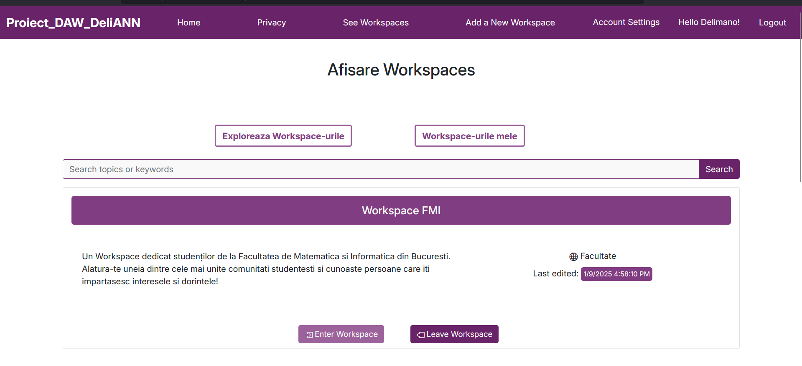
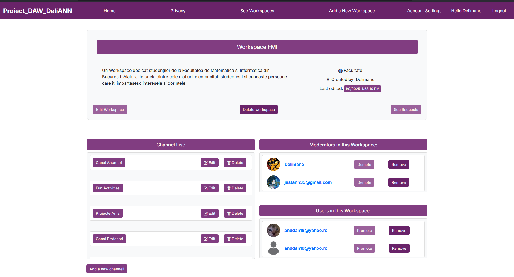
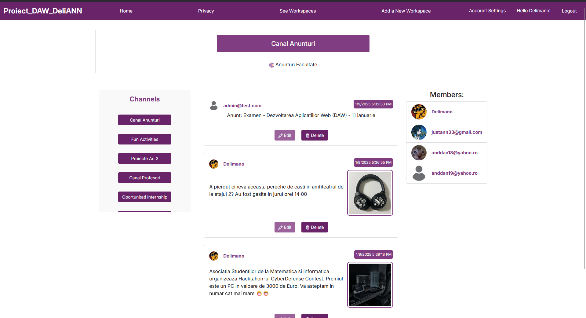
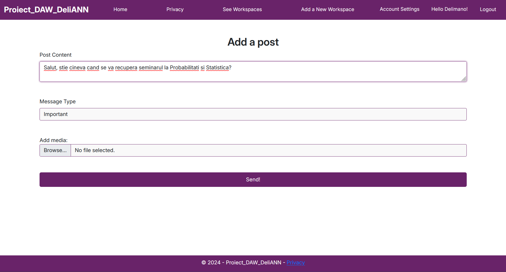

# WorkSpace App – DeliANN

A **full-stack collaboration platform** built with **ASP.NET**.  
The app provides team-oriented features similar to Slack/Microsoft Teams, enabling communication, organization, and collaboration in different work environments.

---

## ✨ Features

- **Authentication & Roles**
  - An **admin account** is created automatically:
    - **Email:** `admin@test.com`
    - **Password:** `Admin1!;`
  - Use this account to access all functionalities of the app.
- **Workspace Management**
  - Users can **create new workspaces** or request to join/leave existing ones.
  - Each workspace has **moderators** who accept/reject join requests.
  - Workspaces are organized into **multiple channels**, allowing focused discussions by topic.
  - Workspaces can also be **filtered by categories** to match user interests.
- **User Profiles**
  - Users can **view each other’s profiles** and update their own information.
- **Collaboration Tools**
  - Real-time messaging inside workspaces and channels.
  - Supports file sharing and media content.

---

## 🛠️ Tech Stack

- **Backend:** ASP.NET (C#), LINQ
- **Frontend:** HTML, CSS, BOOTSTRAP, BLAZOR
- **Database:** SQL Server (Microsoft)
- **Other:** Entity Framework, MVC pattern

---

## 🚀 Getting Started

Follow these steps to run the project locally:

1. **Clone the repository**
   ```console
   git clone https://github.com/Delian-dev/WorkSpace-App--DeliANN.git

2. **Open in Visual Studio**  
   Open the solution file `Proiect_DAW-DeliANN.sln` in Visual Studio (2019 or newer).

3. **Set up the database**
   - Update the connection string in `appsettings.json` to match your SQL Server instance.
   - Run Entity Framework migrations:
     ```bash
     dotnet ef database update
     ```

4. **Build and run**
   - Build the project in Visual Studio.
   - Press **F5** to run locally.
   - The app should be available at `https://localhost:5001` (or whichever port Visual Studio configures).

---

## 📸 Screenshots

### Workspaces Page


### Workspace Interface


### Channels


### Add Posts

---

## 📜 License
This project is for educational purposes.  
Feel free to explore and adapt the code for learning.
